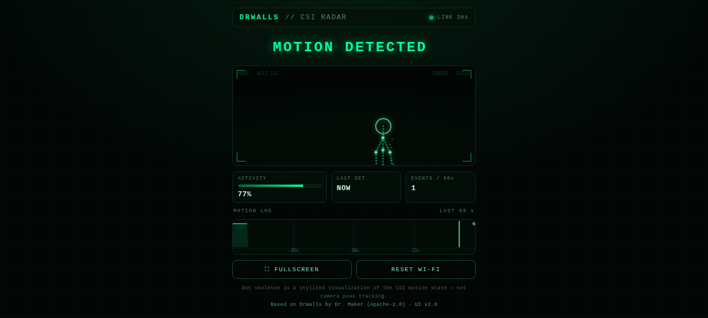

# GDZero

**See motion through Wi-Fi — with zero extra hardware.**

By **Team Gradient_Zero** — built on top of the original [DrWalls](https://github.com/drmakerr/DrWalls) project by Dr. Maker.

---

## ⚡ Install in one click — no tools needed

### [👉 INSTALL GDZERO ON YOUR ESP32](https://darwish-v12.github.io/GDZero/)

Connect the ESP32 with a USB **data** cable and click **Install**. The firmware
flashes straight from the browser — no ESP-IDF, no VS Code, no Python, no compilation.

> Requires **Google Chrome** or **Microsoft Edge** on desktop (Web Serial).
> First time on that board? The installer will offer **Erase Device** — accept it.

---

## What you need

| Item | Notes |
|---|---|
| 1× ESP32 | the only piece of hardware |
| 1× USB cable | data cable — power + flashing |
| Any Wi-Fi router | 2.4 GHz — one you already own |
| Chrome or Edge | on a computer |

**0 extra sensors. No camera. No PIR. No wiring.**

---

## How it works

Wi-Fi signals travel through your room between the router and the ESP32.
When a person moves, they bend those signals. GDZero reads the
**Channel State Information (CSI)** — how the signal travels, not what it
carries — and turns the disturbance into a motion event.

> It never reads your data. It only feels how the signal changes.

---

## What's new in v2 — the Radar Dashboard



- 🎯 **Military Radar UI** — a dot-skeleton figure walks the radar while motion
  is detected, and breathes when someone is present.
- 📈 **60s Motion Log** — a live timeline stamps every detection of the last minute.
- 🛰 **Auto Demo Mode** — no device reachable? The radar simulates a target
  automatically (amber `DEMO` badge) — perfect for practicing the presentation.
- ⛶ **Fullscreen** — one click turns the whole screen into the radar.
- 🟢 **`LINK` / `DEMO` badge** — green means the dashboard is connected to the
  device; amber means it is simulating.

---

## After installation

1. The ESP32 creates a temporary Wi-Fi network: **`DrWalls-Setup`**.
2. Connect to it from your phone or computer — the setup portal opens
   (or browse to `http://192.168.4.1`).
3. Pick your router and enter its password — once.
4. The ESP32 restarts and joins your network.
5. Open:

```text
http://drwalls.local
```

The v2 radar dashboard appears. Move — watch the skeleton walk.

---

## Reset Wi-Fi

Need to change the network? Press **RESET WI-FI** on the dashboard.
The ESP32 erases the saved credentials and returns to `DrWalls-Setup` mode.

---

## Privacy

- Wi-Fi credentials are entered through the local setup portal and stored only
  in the ESP32's NVS storage.
- No credentials, images, or personal data are included in this repository or
  in the firmware.
- The dashboard shows a **visualization of motion state** — never a picture of you.

---

## Project origin

GDZero is based on and extends:

- Espressif's **[ESP-CSI](https://github.com/espressif/esp-csi)** `wifi_sensing_demo` — the Wi-Fi sensing
  implementation is developed by Espressif Systems.
- **[DrWalls](https://github.com/drmakerr/DrWalls)** by Dr. Maker — the end-user workflow: browser-based
  installation, first-time Wi-Fi provisioning, captive setup portal, mDNS access
  and Wi-Fi reset.

GDZero v2 adds the military-radar dashboard UI, the 60-second motion log,
auto demo mode and fullscreen presentation mode, embedded directly in the firmware.

---

## Author

Created by **Dr. Maker** — **Team Gradient_Zero**.

Made with Love <3 for all makers.

---

## 📂 Repository guide

| File | What it is |
|---|---|
| **[SETUP_GUIDE.md](SETUP_GUIDE.md)** | الدليل الكامل بالعربي — browser install + build from source + troubleshooting |
| **[GDZero_Presentation.pdf](GDZero_Presentation.pdf)** | Project presentation deck — Team Gradient_Zero |
| `index.html` + `manifest.json` + `firmware/` | The one-click web installer (ESP Web Tools) |

> 🎯 Practicing the demo? Open `main/drwalls_dashboard.html` directly in a browser — it runs in **DEMO mode** with a simulated target.

---

## License

GDZero is released under the **Apache License 2.0**.

Original Espressif source files retain their respective copyright and SPDX license notices.
